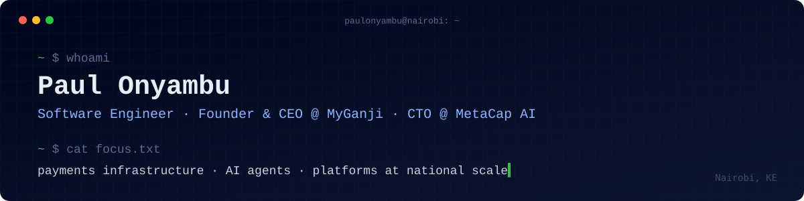

  

  
  

I'm a software engineer in Nairobi. I build payments and AI systems for African markets, and I lead the companies that ship them.

- **Founder & CEO, [MyGanji](https://myganji.com)**: payments infrastructure for Kenya.
- **CTO, [MetaCap AI](https://metacap.ai)**: autonomous AI systems that run sales, marketing and operations for businesses.

I've shipped a lot of projects, and most of the code is private to products and clients. These are the largest.

### Flagship projects

| Project | What it does |
|---|---|
| **[MyGanji PayHub](https://myganji.com)** | Payments engine for businesses. Handles C2B collections and B2C disbursements through a single integration. |
| **[MetaCap AI Sales Crew](https://salescrew.metacap.ai)** | An AI sales team. Voice agents take and make calls, remember returning callers, answer from a knowledge base, and qualify and capture leads, all orchestrated from one dashboard. |
| **[MetaCap AI Marketing Crew](https://marketingcrew.metacap.ai)** | A multi-channel AI agent platform. Agents create, schedule and publish content across social and messaging channels from one command centre. |
| **[.KE Digital Starter Pack](https://digitalstarterpack.ke)** | Kenya's national digital onboarding platform. Gives schools, health centres, NGOs and businesses a .ke domain, website, hosting and business email, provisioned automatically. |
| **[Hack-a-Milli](https://hack-a-milli.kenic.or.ke)** | I led development of the platform for KeNIC's national app-development hackathon for university students across Kenya, with a KES 1.5M prize pool. |

### What I work with

- **Languages & frameworks:** TypeScript, React, Next.js, Vite, Astro
- **Backend & data:** Supabase, Postgres, pgvector, Edge Functions
- **Payments & telephony:** M-PESA Daraja API, SIP
- **Infra & AI:** Vercel, GitHub Actions, LLM APIs, voice AI, AI-assisted development

### Get in touch

- **MyGanji:** [paul@myganji.com](mailto:paul@myganji.com)
- **MetaCap AI:** [pauloh@metacap.ai](mailto:pauloh@metacap.ai)
- **Personal:** [tech.pauloh@gmail.com](mailto:tech.pauloh@gmail.com)
- **Call / WhatsApp:** [+254 724 213 381](https://wa.me/254724213381)
- **LinkedIn:** [linkedin.com/in/paul-onyambu](https://www.linkedin.com/in/paul-onyambu/)

<!-- Portfolio: add here once live -->
